<div align="center">

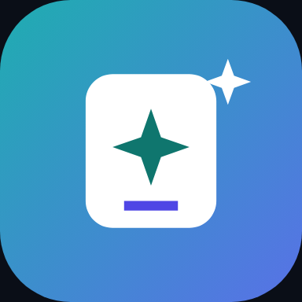

# Dọn Sạch — Smart Cleaner

**Dọn ảnh trùng, ảnh na ná, ảnh mờ, video lớn và tệp rác — hoàn toàn trên máy.**<br/>
Miễn phí · Không quảng cáo · Không Internet · Mã nguồn mở

[](https://developer.android.com)
[](https://kotlinlang.org)
[](https://developer.android.com/jetpack/compose)
[](https://m3.material.io)
[](LICENSE)
[](https://github.com/gooduselabs/smart-cleaner/releases/latest)


<a href="https://github.com/gooduselabs/smart-cleaner/releases/latest"></a>

</div>

> [!WARNING]
> **Bản thử nghiệm sớm (debug build v0.1.0), chưa kiểm thử trên điện thoại thật.** Thuật toán băm/gom nhóm/đo độ nét đã có unit test, giao diện được chụp bằng Roborazzi với **dữ liệu mẫu**; các luồng MediaStore, nén video và ML Kit chưa được xác minh trên thiết bị. Hãy thử với ảnh đã sao lưu và báo lỗi qua [Issues](https://github.com/gooduselabs/smart-cleaner/issues).

---

## 📸 Ảnh màn hình

| Tổng quan | Ảnh tương tự | So sánh |
|:---:|:---:|:---:|
| 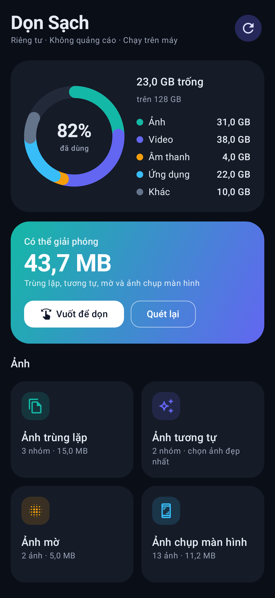 | 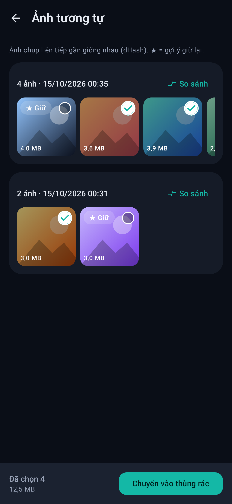 | 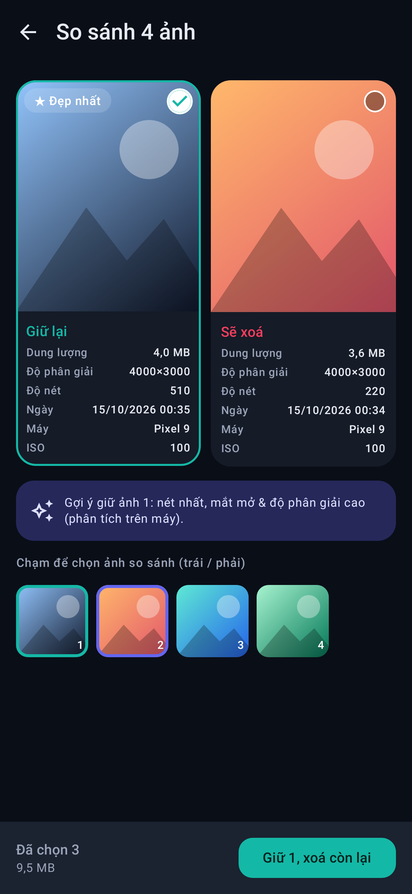 |
| **Vuốt để dọn** | **Video & nén** | **Ứng dụng** |
| 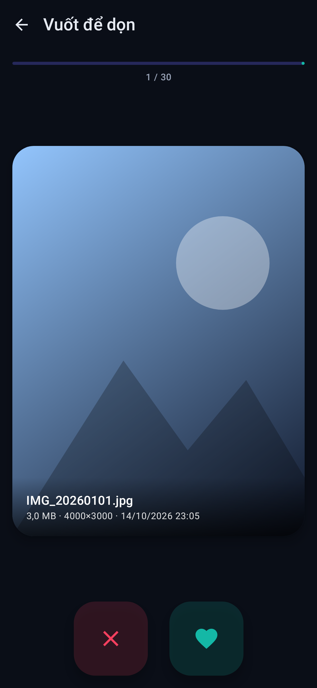 | 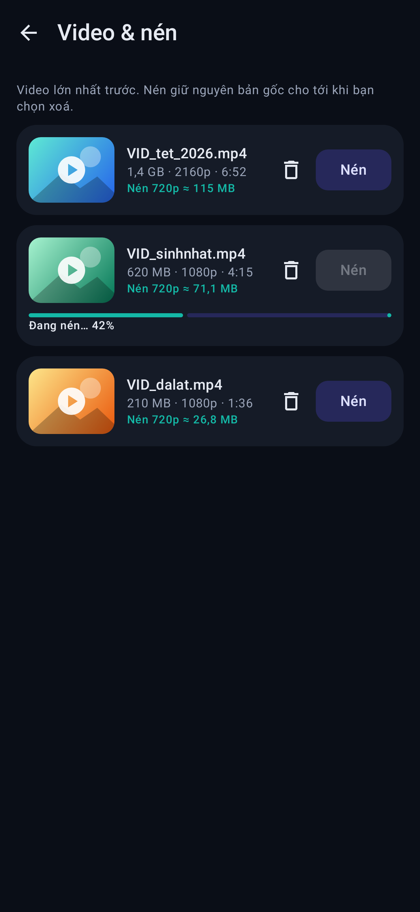 | 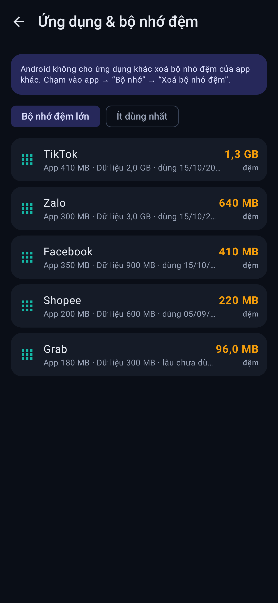 |
| **Chế độ sáng** | **Trùng lặp (sáng)** | **Thùng rác** |
| 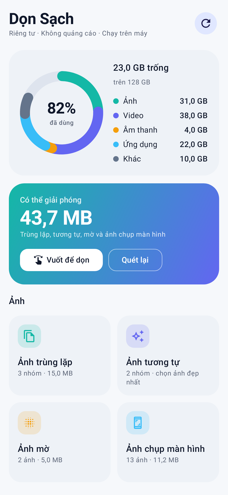 | 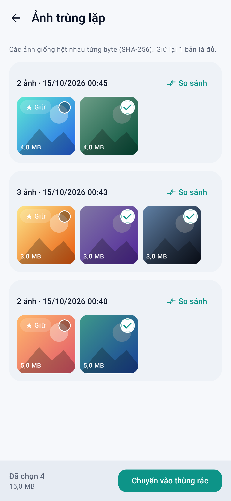 | 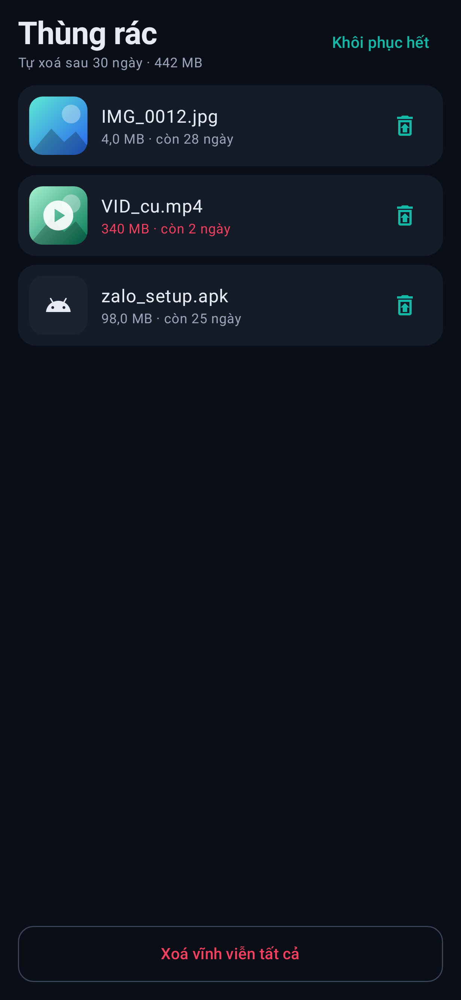 |
| **Giới thiệu** | **Cài đặt** | **Trạng thái trống** |
| 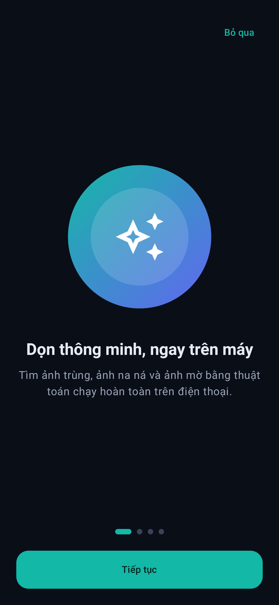 | 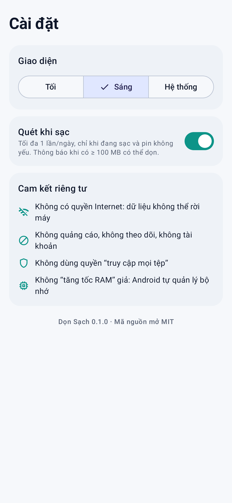 | 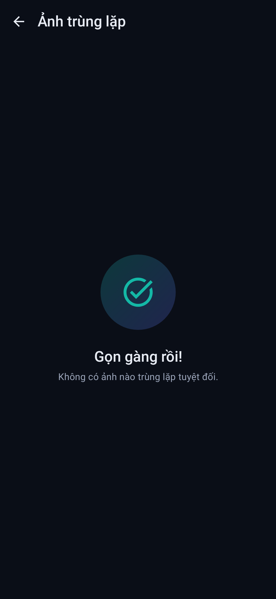 |

<sub>Ảnh minh hoạ dùng dữ liệu mẫu, không phải ảnh thật.</sub>

## ✨ Tính năng

**📊 Tổng quan bộ nhớ** — biểu đồ vòng: ảnh, video, âm thanh, ứng dụng, khác; ước tính dung lượng có thể giải phóng.

**🖼️ Ảnh**
- 🟰 **Trùng lặp tuyệt đối** — SHA-256 (chỉ băm các ảnh cùng kích thước byte → nhanh)
- ✨ **Ảnh tương tự** — perceptual hash (dHash 64-bit) + khoảng cách Hamming, gom theo cửa sổ thời gian
- 🌫️ **Ảnh mờ** — phương sai toán tử Laplace
- ⭐ **Gợi ý ảnh đẹp nhất** — độ nét + ML Kit Face Detection (mắt mở, cười) + độ phân giải
- 🔍 **So sánh song song** — dung lượng, độ phân giải, độ nét, EXIF (máy, ISO, khẩu độ…)
- 👆 **Vuốt để giữ / xoá**, có hoàn tác từng bước
- 📱 Ảnh chụp màn hình, 📥 ảnh/video tải xuống cũ (> 90 ngày)

**🎬 Video & tệp**
- 🗜️ **Nén video** bằng Media3 Transformer (1080p / 720p / 480p, H.264), xem trước dung lượng ước tính, tuỳ chọn bỏ bản gốc vào thùng rác
- 📦 Tệp lớn ≥ 50 MB
- 🧩 APK và thư mục rỗng trong thư mục bạn chọn (Storage Access Framework)
- 📲 Dung lượng & bộ nhớ đệm từng ứng dụng, sắp theo cache hoặc “ít dùng nhất”, chạm để mở Cài đặt app

**🛡️ An toàn & riêng tư**
- 🗑️ **Thùng rác 30 ngày** với hoàn tác (MediaStore `createTrashRequest` / `createDeleteRequest`, luôn có hộp thoại xác nhận của hệ thống)
- 🔌 **Quét khi sạc** (WorkManager: đang sạc + pin không yếu, 1 lần/ngày) và thông báo khi có ≥ 100 MB có thể dọn
- 🚫 Không quyền Internet, không `MANAGE_EXTERNAL_STORAGE`, không quảng cáo, không tài khoản
- 🌗 Giao diện tối (mặc định) / sáng / theo hệ thống, onboarding, splash, icon thích ứng (có monochrome)

## ⚖️ So sánh

| | **Dọn Sạch** | App dọn dẹp phổ biến có quảng cáo |
|---|:---:|:---:|
| Quảng cáo | ❌ Không | Thường có |
| Gói thuê bao / dùng thử tự gia hạn | ❌ Không | Thường có |
| Cần Internet | ❌ Không (không có quyền) | Có |
| Phân tích ảnh | Trên máy | Tuỳ app |
| Thùng rác & hoàn tác | ✅ 30 ngày | Tuỳ app |
| So sánh EXIF / độ phân giải | ✅ | Ít app có |
| “Tăng tốc RAM” | ❌ Cố ý không làm (vô tác dụng trên Android hiện đại) | Thường có |
| Mã nguồn mở | ✅ MIT | Hiếm |

## ⚠️ Giới hạn thật của Android

- **Không xoá được cache của app khác** — Android không cho phép; app chỉ hiển thị và mở trang Cài đặt app.
- **Chỉ thấy ảnh/video/âm thanh** qua MediaStore. Tệp khác (APK, thư mục rỗng) chỉ quét được trong thư mục bạn cấp quyền; Android 11+ không cho chọn gốc bộ nhớ hay gốc thư mục Download.
- **Không có “tăng RAM”, không dọn email** — có chủ đích.
- Xoá/khôi phục ảnh luôn cần bạn xác nhận trong hộp thoại hệ thống.
- Ngưỡng độ nét và độ tương tự là heuristic, có thể nhận nhầm — luôn xem lại trước khi xoá.

## 🛠️ Build

Yêu cầu: JDK 17+ (đã thử JDK 21), Android SDK 35.

```bash
git clone https://github.com/gooduselabs/smart-cleaner.git
cd smart-cleaner
echo "sdk.dir=$ANDROID_HOME" > local.properties
./gradlew testDebugUnitTest assembleDebug
# APK: app/build/outputs/apk/debug/app-debug.apk
```

Ảnh màn hình Roborazzi được ghi vào `../screens` khi chạy `testDebugUnitTest`.

**Công nghệ:** Kotlin · Jetpack Compose · Material 3 · MVVM · Room · WorkManager · MediaStore · SAF · ML Kit Face Detection · Media3 Transformer · Robolectric + Roborazzi.

## 🗺️ Lộ trình

- [x] v0.1 — tổng quan, trùng/tương tự/mờ, so sánh, vuốt, video & nén, tệp lớn, APK/thư mục rỗng, ứng dụng, thùng rác, quét khi sạc
- [ ] Kiểm thử trên nhiều thiết bị thật, tinh chỉnh ngưỡng độ nét/tương tự
- [ ] Bản release ký số + R8 (giảm dung lượng APK)
- [ ] Nén HEVC khi thiết bị hỗ trợ, nén ảnh
- [ ] Video tương tự, nhóm ảnh “tài liệu/hoá đơn”
- [ ] Widget dung lượng, F-Droid

## 📄 Giấy phép

[MIT](LICENSE). Viết mới hoàn toàn (clean-room): không dùng mã, hình ảnh hay thương hiệu của ứng dụng khác.
